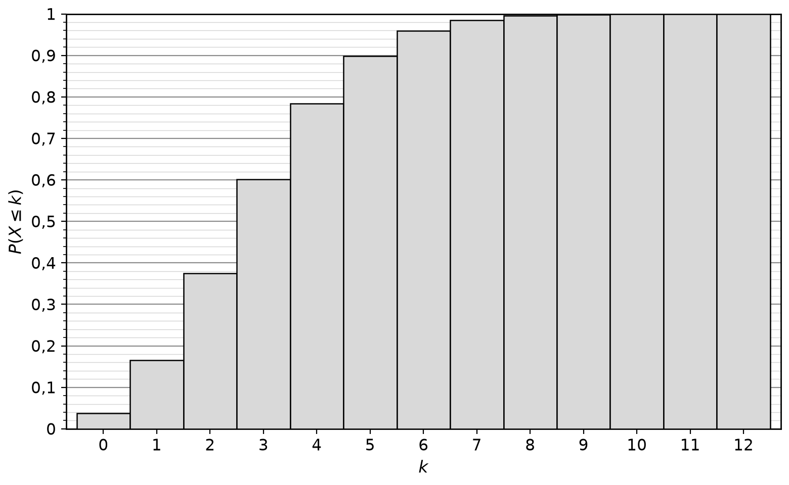
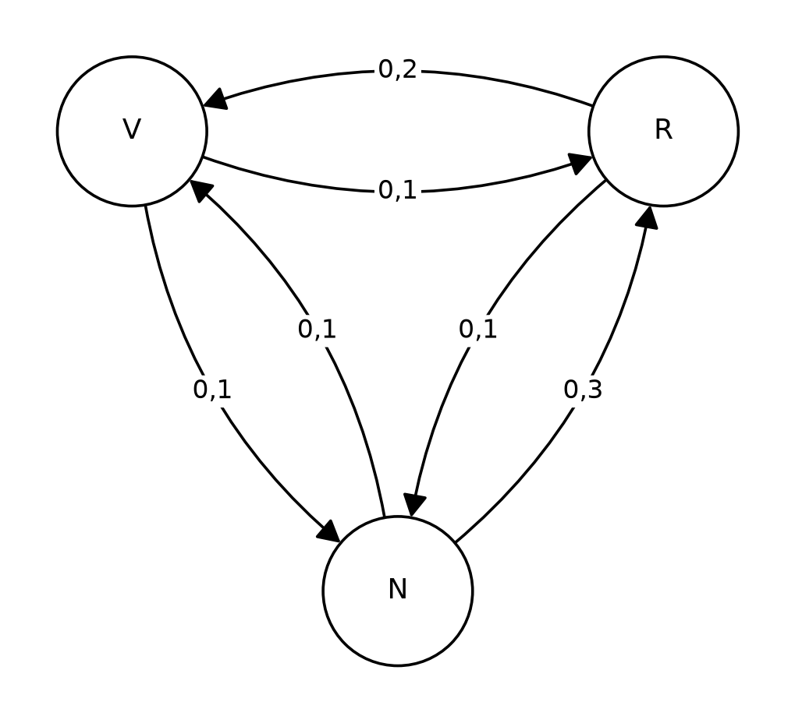
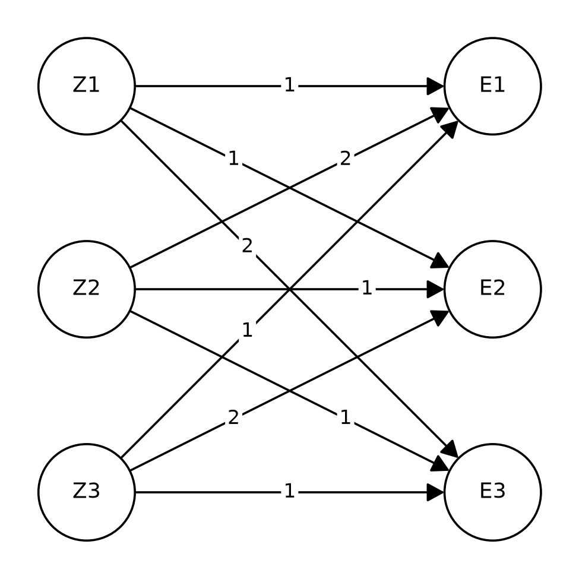
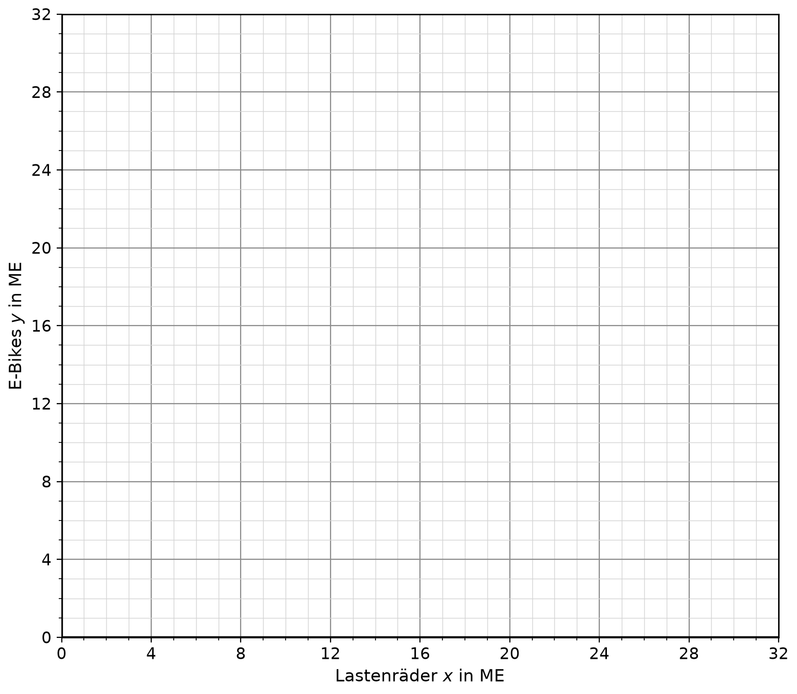

# Aufgaben

Die **VeloNord GmbH** aus Bremen entwickelt und fertigt Fahrräder, E-Bikes, Lastenräder und Zubehör. In allen Aufgaben bezeichnet ME die Mengeneinheit und GE die Geldeinheit.

# Teil A (ohne Hilfsmittel)

Bearbeiten Sie die Pflichtaufgaben 1.1 bis 1.4 und zwei der vier Wahlaufgaben 1.5 bis 1.8.

## Aufgabe 1.1

Der Fahrradhelm „Aero“ wird in vollständiger Konkurrenz zum Marktpreis von 30 GE/ME angeboten. Die Gesamtkosten der Produktion beschreibt die ertragsgesetzliche Kostenfunktion $K$ mit

$$K(x)=x^3-9x^2+30x+36,\qquad x\ge 0.$$

Dabei ist $x$ die Produktionsmenge in ME und $K(x)$ die Gesamtkosten in GE.

a) Bestimmen Sie die gewinnmaximale Menge und weisen Sie nach, dass es sich um ein Maximum handelt. \punkte{3}

b) Berechnen Sie den maximalen Gewinn. Die Geschäftsführung möchte wissen, ob der Marktpreis bei dieser Menge auch die Stückkosten deckt. Beurteilen Sie dies. \punkte{2}

\newpage

## Aufgabe 1.2

Der Absatz des Fahrradcomputers „VeloTrack“ nach der Markteinführung wird modelliert durch

$$a(t)=4t\cdot e^{-0{,}5t},\qquad t\ge 0.$$

Dabei ist $t$ die Zeit in Monaten seit der Markteinführung und $a(t)$ der Absatz in Tausend Stück pro Monat. Eine Stammfunktion von $a$ ist $F$ mit $F(t)=-(8t+16)\cdot e^{-0{,}5t}$.

a) Zeigen Sie, dass $F$ eine Stammfunktion von $a$ ist. \punkte{2}

b) Der Vertrieb vermutet, dass in den ersten vier Monaten mehr als 10 000 Stück verkauft werden. Prüfen Sie diese Vermutung. Verwenden Sie $e^{-2}\approx 0{,}14$. \punkte{3}

\newpage

## Aufgabe 1.3

Im Fachgeschäft der VeloNord GmbH machen 30 % der Interessenten eine Probefahrt. Von den Interessenten mit Probefahrt kaufen 60 % ein Rad, von den Interessenten ohne Probefahrt kaufen 20 % ein Rad.

a) Stellen Sie die Situation in einem Baumdiagramm einschließlich aller Pfadwahrscheinlichkeiten dar und berechnen Sie die Wahrscheinlichkeit, dass ein zufällig ausgewählter Interessent ein Rad kauft. \punkte{3}

b) Ein Interessent hat ein Rad gekauft. Berechnen Sie die Wahrscheinlichkeit, dass er zuvor eine Probefahrt gemacht hat, und vergleichen Sie diese mit dem Anteil der Probefahrer unter allen Interessenten. \punkte{2}

\newpage

## Aufgabe 1.4

Die City-Bikes $E_1$ und die Trekkingbikes $E_2$ werden zweistufig gefertigt: Aus den Rohstoffen $R_1$ (Aluminium) und $R_2$ (Stahl) entstehen die Module $Z_1$ (Rahmenmodul) und $Z_2$ (Antriebsmodul), aus diesen die Räder. Die Rohstoff-Modul-Matrix $RZ$ und die Modul-Endprodukt-Matrix $ZE$ lauten

$$RZ=\begin{pmatrix}2&1\\1&3\end{pmatrix},\qquad ZE=\begin{pmatrix}1&2\\2&1\end{pmatrix}.$$

Die Zeilen von $RZ$ gehören zu den Rohstoffen, die Spalten zu den Modulen; die Zeilen von $ZE$ gehören zu den Modulen, die Spalten zu den Rädern.

a) Berechnen Sie die Rohstoff-Endprodukt-Matrix $RE$ und erläutern Sie die Bedeutung des Eintrags in der zweiten Zeile und ersten Spalte. \punkte{3}

b) Im Folgenden gilt $RE=\begin{pmatrix}4&5\\7&5\end{pmatrix}$. Im Lager liegen noch 120 ME Aluminium und 165 ME Stahl. Diese Bestände sollen vollständig zu City- und Trekkingbikes verarbeitet werden. Bestimmen Sie, wie viele ME von $E_1$ und $E_2$ gefertigt werden. \punkte{2}

\newpage

## Aufgabe 1.5 – Wahlaufgabe

Auf dem Markt für Kinderanhänger „Kiddo“ gelten die Nachfragefunktion $p_N$ und die Angebotsfunktion $p_A$ mit

$$p_N(x)=36-x^2\qquad\text{und}\qquad p_A(x)=x^2+6x,\qquad 0\le x\le 6.$$

Dabei ist $x$ die Menge in ME und $p_N(x)$ bzw. $p_A(x)$ der Preis in GE/ME.

a) Bestimmen Sie die Gleichgewichtsmenge und den Gleichgewichtspreis. \punkte{2}

b) Berechnen Sie die Konsumentenrente im Marktgleichgewicht und erläutern Sie ihre Bedeutung im Sachzusammenhang. \punkte{3}

\newpage

## Aufgabe 1.6 – Wahlaufgabe

Die Zahl der Nutzer der Routen-App „VeloRoute“ wächst exponentiell und wird beschrieben durch

$$N(t)=a\cdot e^{b\cdot t},\qquad t\ge 0.$$

Dabei ist $t$ die Zeit in Jahren seit dem Start der App und $N(t)$ die Nutzerzahl in Tausend. Beim Start hatte die App 4 000 Nutzer, nach zwei Jahren 36 000 Nutzer.

a) Bestimmen Sie $a$ und $b$. \punkte{3}

b) Ermitteln Sie, nach wie vielen Jahren die App 324 000 Nutzer hat. \punkte{2}

\newpage

## Aufgabe 1.7 – Wahlaufgabe

Beim Lackieren der Lenker müssen erfahrungsgemäß 10 % nachlackiert werden. In einer Charge werden 50 Lenker lackiert. Die Zufallsgröße $X$ beschreibt die Anzahl der nachzulackierenden Lenker einer Charge und ist binomialverteilt mit $n=50$ und $p=0{,}1$.

Für die Verteilungsfunktion $F(k)=P(X\le k)$ gilt:

| $k$ | 4 | 5 | 6 | 7 | 8 | 9 | 10 |
|---|---|---|---|---|---|---|---|
| $F(k)$ | 0,431 | 0,616 | 0,770 | 0,878 | 0,942 | 0,976 | 0,991 |

a) Bestimmen Sie mithilfe der Tabelle die Wahrscheinlichkeit, dass in einer Charge mindestens 8 Lenker nachlackiert werden müssen. \punkte{2}

b) Die Werkstatt will so viele Nachlackierplätze einrichten, dass diese mit einer Wahrscheinlichkeit von mindestens 95 % für eine Charge ausreichen. Bestimmen Sie die dafür nötige Mindestanzahl an Plätzen. \punkte{3}

\newpage

## Aufgabe 1.8 – Wahlaufgabe

Die Kundschaft der VeloNord GmbH lässt ihre Räder jährlich warten, entweder im VeloNord-Service ($V$) oder in einer freien Werkstatt ($F$). Jedes Jahr bleiben 80 % der Kunden des VeloNord-Service dort; 20 % wechseln zur freien Werkstatt. Von den Kunden der freien Werkstatt wechseln 30 % zum VeloNord-Service. Das Wechselverhalten ändert sich über die Jahre nicht.

a) Stellen Sie die Übergangsmatrix $M$ auf (Reihenfolge $V$, $F$; Spalten: von, Zeilen: nach). Aktuell nutzen beide Angebote je die Hälfte der Kundschaft. Berechnen Sie die Verteilung nach einem Jahr. \punkte{2}

b) Bestimmen Sie die stationäre Verteilung und deuten Sie das Ergebnis im Sachzusammenhang. \punkte{3}

\newpage

# Teil B (mit Hilfsmitteln)

## Aufgabe 2

Die VeloNord GmbH untersucht Kosten, Absatz und Preise ihrer Produkte.

Das Fahrradschloss „Secura“ wird in vollständiger Konkurrenz angeboten. Die Gesamtkosten der Produktion beschreibt die ertragsgesetzliche Kostenfunktion $K$ mit

$$K(x)=0{,}25x^3-3x^2+14x+30,\qquad x\ge 0.$$

Dabei ist $x$ die Produktionsmenge in ME und $K(x)$ die Gesamtkosten in GE.

a) Bestimmen Sie den Wendepunkt von $K$ und die Höhe der minimalen Grenzkosten. Erläutern Sie die Bedeutung des Wendepunkts im Sachzusammenhang. \punkte{3}

b) Berechnen Sie das Betriebsoptimum und die langfristige Preisuntergrenze. \punkte{3}

c) Der Marktpreis beträgt 14 GE/ME. Bestimmen Sie Gewinnschwelle und Gewinngrenze sowie die gewinnmaximale Menge mit dem maximalen Gewinn. \punkte{4}

Für das E-Bike „Fjord“ modelliert die VeloNord GmbH den Absatz nach der Markteinführung durch

$$s_a(t)=(a\cdot t-t^2)\cdot e^{-0{,}2t},\qquad 0\le t\le a,\ a>0.$$

Dabei ist $t$ die Zeit in Monaten seit der Markteinführung und $s_a(t)$ der Absatz in ME pro Monat (1 ME entspricht 10 E-Bikes). Nach $t=a$ Monaten wird das Modell vom Markt genommen ($s_a(a)=0$).

d) Der Vertrieb erwartet den größten monatlichen Absatz vier Monate nach der Markteinführung. Bestimmen Sie dazu den Wert von $a$ und weisen Sie nach, dass dann bei $t=4$ tatsächlich ein Maximum vorliegt. Geben Sie den maximalen Absatz an. \punkte{4}

Im Folgenden gilt $a=24$, also $s(t)=(24t-t^2)\cdot e^{-0{,}2t}$ für $0\le t\le 24$.

e) Berechnen Sie den Gesamtabsatz im ersten Jahr nach der Markteinführung und seinen Anteil am Gesamtabsatz des gesamten Lebenszyklus. Beurteilen Sie, ob sich eine Verlängerung des Lebenszyklus über das erste Jahr hinaus für den Absatz noch lohnt. \punkte{3}

f) Die Produktion soll eingestellt werden, sobald der monatliche Absatz nach dem Maximum unter 5 ME fällt. Bestimmen Sie den Zeitpunkt der Einstellung. \punkte{3}

Für das Lastenrad „Cargo“ untersucht die VeloNord GmbH den Markt. Eine Marktstudie liefert folgende Zusammenhänge zwischen der nachgefragten Menge $x$ in ME und dem Preis $p$ in GE/ME:

| $x$ in ME | 1 | 2 | 3 | 5 | 7 | 9 |
|---|---|---|---|---|---|---|
| $p$ in GE/ME | 101 | 83 | 71 | 48 | 35 | 24 |

g) Bestimmen Sie mithilfe von Regression eine exponentielle und eine lineare Funktion, die den Zusammenhang beschreiben. Beurteilen Sie, welche Funktion besser geeignet ist. Berücksichtigen Sie dabei das Bestimmtheitsmaß und die Prognose für $x=12$. \punkte{4}

Im Folgenden gilt für die Nachfragefunktion $p_N(x)=120\cdot e^{-0{,}18x}$ und für die Angebotsfunktion $p_A(x)=0{,}5x^2+4$ (jeweils $x\ge 0$).

h) Bestimmen Sie die Gleichgewichtsmenge und den Gleichgewichtspreis. \punkte{3}

i) Im Marktgleichgewicht gilt $x_G=7{,}42$ ME und $p_G=31{,}55$ GE/ME. Berechnen Sie die Konsumenten- und die Produzentenrente. Erläutern Sie, was der Vergleich der beiden Renten für die Marktteilnehmer aussagt. \punkte{3}

\newpage

## Aufgabe 3

Das Qualitätsmanagement der VeloNord GmbH untersucht Vertrieb, Garantie und Lieferqualität.

Das Lastenrad „Cargo“ kann online (O) oder im Fachhandel bestellt werden. Bei einer zufällig ausgewählten Bestellung wird mit einer Wahrscheinlichkeit von 0,60 online bestellt, mit einer Wahrscheinlichkeit von 0,11 wird das Rad zurückgeschickt (Retoure, $R$), und mit einer Wahrscheinlichkeit von 0,09 wird es online bestellt und zurückgeschickt.

a) Stellen Sie die Situation in einer Vierfeldertafel dar und prüfen Sie, ob Online-Bestellung und Retoure stochastisch unabhängig sind. \punkte{4}

b) Berechnen Sie die Retourenquote bei Online-Bestellungen und bei Bestellungen im Fachhandel. Eine zurückgesandte Bestellung wird zufällig ausgewählt: Berechnen Sie die Wahrscheinlichkeit, dass sie online aufgegeben wurde, und deuten Sie den Vergleich mit 0,60. \punkte{3}

c) Die VeloNord GmbH führt für Online-Bestellungen eine Rücksendegebühr ein. Dadurch sinkt die Retourenquote bei Online-Bestellungen auf $q$. Im Fachhandel liegt sie weiter bei 5 %, der Anteil der Online-Bestellungen bei 60 %. Die Retourenquote über alle Bestellungen soll höchstens 8 % betragen. Bestimmen Sie den größten zulässigen Wert von $q$. \punkte{3}

Für das E-Bike „Fjord“ gewährt die VeloNord GmbH zwei Jahre Garantie. Ein Akkufehler tritt mit einer Wahrscheinlichkeit von 0,04 auf, ein Motorfehler mit einer Wahrscheinlichkeit von 0,03, beide Fehler unabhängig voneinander. Die Garantiekosten je E-Bike betragen bei einem Akkufehler 250 €, bei einem Motorfehler 400 € und bei beiden Fehlern 600 € (kombinierte Reparatur); sonst entstehen keine Kosten.

d) Die Zufallsgröße $Y$ beschreibt die Garantiekosten je E-Bike. Geben Sie die Wahrscheinlichkeitsverteilung von $Y$ an und berechnen Sie die erwarteten Garantiekosten. Die Herstellkosten betragen 2 340 € je E-Bike. Der Verkaufspreis soll so kalkuliert werden, dass nach Abzug von Herstell- und erwarteten Garantiekosten im Mittel 180 € Gewinn je E-Bike bleiben. Berechnen Sie den Verkaufspreis. \punkte{5}

\newpage

Die VeloNord GmbH liefert E-Bikes in Sendungen zu je 80 Stück an Händler. Erfahrungsgemäß hat jedes E-Bike unabhängig von den anderen mit einer Wahrscheinlichkeit von 4 % einen Akkufehler. Die Zufallsgröße $X$ beschreibt die Anzahl der E-Bikes einer Sendung mit Akkufehler und ist binomialverteilt.

e) Berechnen Sie die Wahrscheinlichkeiten der folgenden Ereignisse. \punkte{5}

- $E_1$: Genau vier E-Bikes einer Sendung haben einen Akkufehler.
- $E_2$: Mehr als ein, aber höchstens fünf E-Bikes haben einen Akkufehler.
- $E_3$: Die Anzahl der E-Bikes mit Akkufehler weicht um mehr als zwei Standardabweichungen vom Erwartungswert ab.

f) Bei der Endkontrolle werden $n$ zufällig ausgewählte E-Bikes geprüft. Mit einer Wahrscheinlichkeit von mindestens 95 % soll dabei mindestens ein Akkufehler entdeckt werden. Ermitteln Sie den kleinsten dafür nötigen Stichprobenumfang $n$. \punkte{3}

g) Jeder Sendung werden $k$ Ersatzakkus beigelegt. Mit einer Wahrscheinlichkeit von mindestens 95 % sollen diese ausreichen, um alle fehlerhaften Akkus der Sendung zu ersetzen. Die Abbildung zeigt die kumulierte Verteilung von $X$. Bestimmen Sie $k$ anhand der Abbildung und bestätigen Sie das Ergebnis rechnerisch. \punkte{3}

{width=75%}

h) Die VeloNord GmbH möchte Händlern garantieren, dass sich in einer Sendung von 80 E-Bikes mit einer Wahrscheinlichkeit von mindestens 90 % höchstens vier Akkufehler befinden. Bestimmen Sie die größte Fehlerwahrscheinlichkeit $p$ (in Prozent, auf zwei Nachkommastellen gerundet), bei der diese Garantie erfüllt ist, und beurteilen Sie, ob die Garantie bei der aktuellen Fehlerquote von 4 % gegeben werden kann. \punkte{4}

\newpage

## Aufgabe 4

Die VeloNord GmbH untersucht Abo-Geschäft, Produktion und Wochenplanung.

Mit „VeloFlat“ ($V$) bietet die VeloNord GmbH ein Fahrrad-Abo an und konkurriert mit „Radiant“ ($R$) und „BikeNow“ ($N$). Die Abo-Kundschaft kann jährlich den Anbieter wechseln, das Wechselverhalten ändert sich über die Jahre nicht. Der Übergangsgraph zeigt die Wechselwahrscheinlichkeiten von einem zum nächsten Jahr. Die Wahrscheinlichkeiten, beim Anbieter zu bleiben, sind nicht eingezeichnet. Aktuell haben VeloFlat 35 %, Radiant 40 % und BikeNow 25 % der Kundschaft.

{width=55%}

a) Stellen Sie die Übergangsmatrix $M$ auf (Reihenfolge $V$, $R$, $N$; Spalten: von, Zeilen: nach). \punkte{2}

Im Folgenden gilt $\vec v_{\text{neu}}=M\cdot\vec v$ mit

$$M=\begin{pmatrix}0{,}8&0{,}2&0{,}1\\0{,}1&0{,}7&0{,}3\\0{,}1&0{,}1&0{,}6\end{pmatrix}.$$

b) Berechnen Sie die Verteilung der Kundschaft nach drei Jahren. \punkte{2}

c) Die Geschäftsleitung möchte wissen, ob VeloFlat langfristig Marktführer wird. Bestimmen Sie dazu die stationäre Verteilung und beurteilen Sie die Frage. \punkte{3}

d) Eine Kampagne soll VeloFlat langfristig einen Marktanteil von 50 % sichern. Durch die Kampagne wechseln von BikeNow jährlich $q$ der Kundschaft zu VeloFlat, 30 % wechseln weiterhin zu Radiant, der Rest bleibt bei BikeNow. Alle übrigen Wahrscheinlichkeiten bleiben unverändert. Bestimmen Sie $q$. \punkte{3}

Die City-Bikes ($E_1$), Trekkingbikes ($E_2$) und E-Bikes ($E_3$) werden zweistufig gefertigt: Aus den Rohstoffen $R_1$ (Aluminium), $R_2$ (Stahl) und $R_3$ (Kunststoff) entstehen die Module $Z_1$ (Rahmenmodul), $Z_2$ (Antriebsmodul) und $Z_3$ (Zubehörmodul), daraus die Räder. Die Mengen, die für je 1 ME der Module benötigt werden, zeigt die Tabelle. Das Diagramm zeigt, wie viele ME der Module für je 1 ME der Räder benötigt werden.

| $RZ$ | $Z_1$ | $Z_2$ | $Z_3$ |
|---|---|---|---|
| $R_1$ | 2 | 1 | 0 |
| $R_2$ | 1 | 3 | 2 |
| $R_3$ | 0 | 1 | 3 |

{width=50%}

e) Bestimmen Sie die Rohstoff-Endprodukt-Matrix $RE$. \punkte{3}

Im Folgenden gilt $RE=\begin{pmatrix}4&3&5\\9&8&7\\5&7&4\end{pmatrix}$.

f) Im Lager liegen noch 175 ME $R_1$, 370 ME $R_2$ und 245 ME $R_3$. Diese Bestände sollen vollständig verbraucht werden. Bestimmen Sie mithilfe der inversen Matrix die dafür nötigen Produktionsmengen der drei Räder und prüfen Sie, ob das Ergebnis sinnvoll ist. \punkte{3}

g) Die Rohstoffkosten je ME der Endprodukte betragen 68 GE ($E_1$), 71 GE ($E_2$) und 61 GE ($E_3$). Bestimmen Sie die Kosten je ME der drei Rohstoffe. Deuten Sie die Rechnung im Sachzusammenhang. \punkte{4}

\newpage

In der Montagehalle werden pro Woche Lastenräder ($x$ ME) und E-Bikes ($y$ ME) gefertigt. Es gelten folgende Beschränkungen:

- Montage: Je ME Lastenräder werden 4 Stunden, je ME E-Bikes 3 Stunden benötigt; insgesamt stehen 120 Stunden zur Verfügung.
- Lackiererei: Je ME Lastenräder wird 1 Stunde, je ME E-Bikes werden 2 Stunden benötigt; insgesamt stehen 50 Stunden zur Verfügung.
- Absatz: Es können höchstens 24 ME Lastenräder abgesetzt werden.

Die Stückdeckungsbeiträge betragen 50 GE/ME für Lastenräder und 70 GE/ME für E-Bikes.

h) Geben Sie das System der Ungleichungen und die Zielfunktion für den Gesamtdeckungsbeitrag an. \punkte{3}

i) Zeichnen Sie den Planungsbereich in das Koordinatensystem ein und ermitteln Sie grafisch das Produktionsprogramm mit dem größten Gesamtdeckungsbeitrag sowie diesen Deckungsbeitrag.

{width=75%}

\punkte{4}

j) Die Montage kann durch Überstunden um 30 Stunden auf 150 Stunden erweitert werden; jede zusätzliche Stunde kostet 5 GE. Alle anderen Beschränkungen und Deckungsbeiträge bleiben unverändert. Ermitteln Sie das dann optimale Produktionsprogramm und beurteilen Sie, ob sich die Überstunden lohnen. \punkte{3}

\newpage

# Lösungen

## Aufgabe 1.1

a) Gewinnfunktion: $G(x)=30x-K(x)=-x^3+9x^2-36$. $G'(x)=-3x^2+18x=-3x(x-6)=0\Leftrightarrow x=0$ oder $x=6$. $G''(x)=-6x+18$, $G''(6)=-18<0$: Maximum. Die gewinnmaximale Menge beträgt 6 ME.

b) $G(6)=-216+324-36=72$. Der maximale Gewinn beträgt 72 GE. Stückkosten bei 6 ME: $k(6)=\dfrac{K(6)}{6}=\dfrac{108}{6}=18$ GE/ME. Der Marktpreis von 30 GE/ME liegt deutlich darüber: Die Stückkosten werden gedeckt, je ME bleiben 12 GE Gewinn ($6\cdot12=72$).

## Aufgabe 1.2

a) Produktregel: $F'(t)=-8\cdot e^{-0{,}5t}-(8t+16)\cdot(-0{,}5)\cdot e^{-0{,}5t}=(-8+4t+8)\cdot e^{-0{,}5t}=4t\cdot e^{-0{,}5t}=a(t)$.

b) $\displaystyle\int_0^4a(t)\,dt=F(4)-F(0)=-48e^{-2}+16\approx16-6{,}72=9{,}28$. In den ersten vier Monaten werden ca. 9 300 Stück verkauft. Die Vermutung (mehr als 10 000 Stück) ist falsch.

## Aufgabe 1.3

a) Pfadwahrscheinlichkeiten ($P$: Probefahrt, $K$: Kauf):

| Pfad | Wahrscheinlichkeit |
|---|---|
| $P\to K$ | $0{,}3\cdot0{,}6=0{,}18$ |
| $P\to\bar K$ | $0{,}3\cdot0{,}4=0{,}12$ |
| $\bar P\to K$ | $0{,}7\cdot0{,}2=0{,}14$ |
| $\bar P\to\bar K$ | $0{,}7\cdot0{,}8=0{,}56$ |

$P(K)=0{,}18+0{,}14=0{,}32$.

b) $P_K(P)=\dfrac{P(P\cap K)}{P(K)}=\dfrac{0{,}18}{0{,}32}=0{,}5625\approx56\ \%$. Unter den Käufern haben 56 % eine Probefahrt gemacht, unter allen Interessenten nur 30 %: Probefahrer kaufen überdurchschnittlich häufig.

## Aufgabe 1.4

a) $RE=RZ\cdot ZE=\begin{pmatrix}2\cdot1+1\cdot2&2\cdot2+1\cdot1\\1\cdot1+3\cdot2&1\cdot2+3\cdot1\end{pmatrix}=\begin{pmatrix}4&5\\7&5\end{pmatrix}$.

Der Eintrag 7 bedeutet: Für 1 ME City-Bikes ($E_1$) werden insgesamt 7 ME Stahl ($R_2$) benötigt.

b) Gesucht ist $\begin{pmatrix}x\\y\end{pmatrix}$ mit $\begin{pmatrix}4&5\\7&5\end{pmatrix}\cdot\begin{pmatrix}x\\y\end{pmatrix}=\begin{pmatrix}120\\165\end{pmatrix}$.

Subtraktion der Gleichungen $7x+5y=165$ und $4x+5y=120$ liefert $3x=45$, also $x=15$; damit $y=\dfrac{120-60}{5}=12$.

Es werden 15 ME City-Bikes und 12 ME Trekkingbikes gefertigt.

## Aufgabe 1.5 – Wahlaufgabe

a) $36-x^2=x^2+6x\Leftrightarrow x^2+3x-18=0\Leftrightarrow x=3$ oder $x=-6$; wegen $x\ge0$ ist $x=3$. Gleichgewichtspreis: $p_N(3)=27$. Gleichgewichtsmenge 3 ME, Gleichgewichtspreis 27 GE/ME.

b) $KR=\displaystyle\int_0^3(36-x^2)\,dx-3\cdot27=\Big[36x-\tfrac13x^3\Big]_0^3-81=108-9-81=18$ GE.

Die Konsumentenrente ist der Gesamtvorteil der Nachfrager, die bereit gewesen wären, mehr als 27 GE/ME zu zahlen, aber zum Gleichgewichtspreis kaufen.

## Aufgabe 1.6 – Wahlaufgabe

a) $N(0)=a=4$. $N(2)=4\cdot e^{2b}=36\Leftrightarrow e^{2b}=9\Leftrightarrow 2b=\ln9=2\ln3\Leftrightarrow b=\ln3\approx1{,}10$. Also $N(t)=4\cdot e^{\ln3\cdot t}$.

b) $4\cdot e^{\ln3\cdot t}=324\Leftrightarrow e^{\ln3\cdot t}=81=3^4=e^{4\ln3}\Leftrightarrow t=4$. Nach 4 Jahren hat die App 324 000 Nutzer.

## Aufgabe 1.7 – Wahlaufgabe

a) $P(X\ge8)=1-P(X\le7)=1-0{,}878=0{,}122$. Mit einer Wahrscheinlichkeit von ca. 12 % müssen mindestens 8 Lenker nachlackiert werden.

b) Gesucht ist das kleinste $k$ mit $P(X\le k)\ge0{,}95$. Es gilt $F(8)=0{,}942<0{,}95$ und $F(9)=0{,}976\ge0{,}95$. Es sind mindestens 9 Nachlackierplätze nötig.

## Aufgabe 1.8 – Wahlaufgabe

a) $M=\begin{pmatrix}0{,}8&0{,}3\\0{,}2&0{,}7\end{pmatrix}$. Verteilung nach einem Jahr: $M\cdot\begin{pmatrix}0{,}5\\0{,}5\end{pmatrix}=\begin{pmatrix}0{,}55\\0{,}45\end{pmatrix}$, also 55 % im VeloNord-Service und 45 % in der freien Werkstatt.

b) Ansatz $M\cdot\vec v=\vec v$ mit $v_V+v_F=1$. Aus der ersten Zeile: $0{,}8v_V+0{,}3v_F=v_V\Leftrightarrow0{,}3v_F=0{,}2v_V\Leftrightarrow v_V=1{,}5\,v_F$. Mit $v_V+v_F=1$ folgt $2{,}5\,v_F=1$, also $v_F=0{,}4$ und $v_V=0{,}6$.

Langfristig nutzen 60 % der Kundschaft den VeloNord-Service und 40 % die freie Werkstatt, unabhängig von der heutigen Verteilung.

\newpage

## Aufgabe 2

a) $K'(x)=0{,}75x^2-6x+14$, $K''(x)=1{,}5x-6=0\Leftrightarrow x=4$; $K'''(x)=1{,}5\neq0$, also Wendepunkt bei $x=4$ mit $K(4)=54$: $W(4\mid54)$. Die Grenzkosten sind dort am geringsten: $K'(4)=2$ GE/ME.

Bedeutung: Bis 4 ME steigen die Gesamtkosten degressiv (der Kostenzuwachs je zusätzlicher ME sinkt), danach progressiv (der Kostenzuwachs steigt).

b) $k(x)=\dfrac{K(x)}{x}=0{,}25x^2-3x+14+\dfrac{30}{x}$, $k'(x)=0{,}5x-3-\dfrac{30}{x^2}=0\Leftrightarrow x\approx7{,}17$; $k''(x)=0{,}5+\dfrac{60}{x^3}>0$, also Minimum. Betriebsoptimum: ca. 7,17 ME. Langfristige Preisuntergrenze: $k(7{,}17)\approx9{,}53$ GE/ME.

c) $G(x)=14x-K(x)=-0{,}25x^3+3x^2-30$. Nullstellen: $G(x)=0\Leftrightarrow x\approx3{,}83$ oder $x\approx11{,}01$ (die Nullstelle $x\approx-2{,}84$ liegt außerhalb des Definitionsbereichs). Gewinnschwelle ca. 3,83 ME, Gewinngrenze ca. 11,01 ME.

$G'(x)=-0{,}75x^2+6x=-0{,}75x(x-8)=0\Leftrightarrow x=0$ oder $x=8$; $G''(x)=-1{,}5x+6$, $G''(8)=-6<0$: Maximum. Gewinnmaximale Menge 8 ME, maximaler Gewinn $G(8)=34$ GE.

d) $s_a'(t)=(a-2t)\cdot e^{-0{,}2t}-0{,}2\,(at-t^2)\cdot e^{-0{,}2t}=\big(0{,}2t^2-(2+0{,}2a)t+a\big)\cdot e^{-0{,}2t}$.

$s_a'(4)=0\Leftrightarrow3{,}2-8-0{,}8a+a=0\Leftrightarrow0{,}2a=4{,}8\Leftrightarrow a=24$.

Für $a=24$: $s_{24}'(t)=0{,}2\,(t-4)(t-30)\cdot e^{-0{,}2t}$. Im Definitionsbereich $0\le t\le24$ gilt $s'>0$ für $t<4$ und $s'<0$ für $4<t<24$: Vorzeichenwechsel von $+$ nach $-$, also Maximum bei $t=4$.

Maximaler Absatz: $s(4)=80\cdot e^{-0{,}8}\approx35{,}95$ ME/Monat (ca. 360 E-Bikes pro Monat).

e) $\displaystyle\int_0^{12}s(t)\,dt\approx307{,}4$ ME; $\displaystyle\int_0^{24}s(t)\,dt\approx357{,}0$ ME. Anteil: $\dfrac{307{,}4}{357{,}0}\approx86\ \%$. Im ersten Jahr werden ca. 3 070 E-Bikes verkauft, im zweiten Jahr nur noch ca. 500. Eine Verlängerung über das erste Jahr hinaus bringt nur noch geringen zusätzlichen Absatz (Absatz nach 12 Monaten: $s(12)\approx13{,}1$ ME/Monat und weiter fallend); sie lohnt sich für den Absatz kaum.

f) $s(t)=5$ hat im Bereich $t>4$ die Lösung $t\approx16{,}16$ (die Lösung $t\approx0{,}22$ liegt vor dem Maximum). Die Produktion wird nach ca. 16,2 Monaten eingestellt.

g) Exponentielle Regression: $p_{\exp}(x)\approx119{,}8\cdot e^{-0{,}1783x}$ mit $R^2\approx0{,}999$.

Lineare Regression: $p_{\text{lin}}(x)\approx-9{,}43x+102{,}78$ mit $R^2\approx0{,}961$.

Die exponentielle Funktion hat das größere Bestimmtheitsmaß. Prognose für $x=12$: $p_{\exp}(12)\approx14{,}1$ GE/ME, aber $p_{\text{lin}}(12)\approx-10{,}4$ GE/ME – ein negativer Preis ist sachlich unsinnig. Die exponentielle Funktion ist besser geeignet; der Preis sinkt mit wachsender Menge immer langsamer.

h) $120\cdot e^{-0{,}18x}=0{,}5x^2+4\Leftrightarrow x\approx7{,}42$. Gleichgewichtspreis: $p_N(7{,}42)\approx31{,}55$. Gleichgewichtsmenge ca. 7,42 ME, Gleichgewichtspreis ca. 31,55 GE/ME.

i) $KR=\displaystyle\int_0^{7{,}42}120\,e^{-0{,}18x}\,dx-7{,}42\cdot31{,}55\approx257{,}2$ GE.

$PR=7{,}42\cdot31{,}55-\displaystyle\int_0^{7{,}42}(0{,}5x^2+4)\,dx\approx136{,}3$ GE.

Die Konsumentenrente ist fast doppelt so groß wie die Produzentenrente: Die Nachfrager profitieren stärker vom Gleichgewichtspreis als die Anbieter; viele Käufer wären bereit gewesen, deutlich mehr als 31,55 GE/ME zu zahlen.

\newpage

## Aufgabe 3

a) 

| | $R$ | $\bar R$ | gesamt |
|---|---|---|---|
| $O$ | 0,09 | 0,51 | 0,60 |
| $\bar O$ | 0,02 | 0,38 | 0,40 |
| gesamt | 0,11 | 0,89 | 1 |

$P(O)\cdot P(R)=0{,}60\cdot0{,}11=0{,}066\neq0{,}09=P(O\cap R)$. Online-Bestellung und Retoure sind stochastisch abhängig.

b) $P_O(R)=\dfrac{0{,}09}{0{,}60}=0{,}15$, $P_{\bar O}(R)=\dfrac{0{,}02}{0{,}40}=0{,}05$. Online-Bestellungen werden dreimal so häufig zurückgeschickt wie Fachhandels-Bestellungen.

$P_R(O)=\dfrac{0{,}09}{0{,}11}\approx0{,}818$. Von den Retouren stammen ca. 82 % aus Online-Bestellungen, obwohl nur 60 % aller Bestellungen online erfolgen: Online-Bestellungen sind unter den Retouren überrepräsentiert.

c) $P(R)=0{,}6\cdot q+0{,}4\cdot0{,}05=0{,}6q+0{,}02\le0{,}08\Leftrightarrow q\le0{,}1$. Die Retourenquote bei Online-Bestellungen darf höchstens 10 % betragen.

d) $P(Y=0)=0{,}96\cdot0{,}97=0{,}9312$, $P(Y=250)=0{,}04\cdot0{,}97=0{,}0388$, $P(Y=400)=0{,}96\cdot0{,}03=0{,}0288$, $P(Y=600)=0{,}04\cdot0{,}03=0{,}0012$.

| $y$ in € | 0 | 250 | 400 | 600 |
|---|---|---|---|---|
| $P(Y=y)$ | 0,9312 | 0,0388 | 0,0288 | 0,0012 |

$E(Y)=250\cdot0{,}0388+400\cdot0{,}0288+600\cdot0{,}0012=9{,}70+11{,}52+0{,}72=21{,}94$ €.

Verkaufspreis: $2340+21{,}94+180=2541{,}94$ €, also ca. 2 542 €.

e) $X\sim B(80;0{,}04)$, $\mu=3{,}2$, $\sigma=\sqrt{80\cdot0{,}04\cdot0{,}96}\approx1{,}753$.

$P(E_1)=P(X=4)\approx0{,}1819$.

$P(E_2)=P(2\le X\le5)=P(X\le5)-P(X\le1)\approx0{,}8988-0{,}1654=0{,}7334$.

$E_3$: $|X-3{,}2|>2\sigma\approx3{,}505$, also $X<-0{,}3$ (unmöglich) oder $X>6{,}7$, d. h. $X\ge7$: $P(E_3)=1-P(X\le6)\approx1-0{,}9588=0{,}0412$.

f) $P(\text{mind. ein Fehler})=1-0{,}96^n\ge0{,}95\Leftrightarrow0{,}96^n\le0{,}05\Leftrightarrow n\ge\dfrac{\ln0{,}05}{\ln0{,}96}\approx73{,}4$. Der kleinste Stichprobenumfang ist $n=74$ (Kontrolle: $0{,}96^{74}\approx0{,}049\le0{,}05$, $0{,}96^{73}\approx0{,}051>0{,}05$).

g) Aus der Abbildung: $P(X\le5)\approx0{,}90<0{,}95$, $P(X\le6)\approx0{,}96\ge0{,}95$, also $k=6$. Rechnerisch: $P(X\le5)\approx0{,}8988$, $P(X\le6)\approx0{,}9588$. Es müssen 6 Ersatzakkus je Sendung beigelegt werden.

h) Gesucht ist das größte $p$ mit $P(X\le4)\ge0{,}9$ für $X\sim B(80;p)$. Lösen der Gleichung $P(X\le4)=0{,}9$ mit dem Rechner liefert $p\approx0{,}0307$, also $p\approx3{,}07\ \%$.

Bei der aktuellen Fehlerquote von 4 % gilt $P(X\le4)\approx0{,}784<0{,}9$. Die Garantie kann bei 4 % nicht gegeben werden; die Fehlerquote müsste auf höchstens 3,07 % sinken.

\newpage

## Aufgabe 4

a) Bleibewahrscheinlichkeiten: $V$: $1-0{,}1-0{,}1=0{,}8$; $R$: $1-0{,}2-0{,}1=0{,}7$; $N$: $1-0{,}1-0{,}3=0{,}6$.

$M=\begin{pmatrix}0{,}8&0{,}2&0{,}1\\0{,}1&0{,}7&0{,}3\\0{,}1&0{,}1&0{,}6\end{pmatrix}$.

b) $M^3\cdot\begin{pmatrix}0{,}35\\0{,}40\\0{,}25\end{pmatrix}\approx\begin{pmatrix}0{,}424\\0{,}370\\0{,}206\end{pmatrix}$. Nach drei Jahren haben VeloFlat ca. 42,4 %, Radiant ca. 37,0 % und BikeNow ca. 20,6 % der Kundschaft.

c) Ansatz $M\cdot\vec v=\vec v$ mit $v_V+v_R+v_N=1$. Lösen des LGS ergibt $\vec v=\begin{pmatrix}0{,}45\\0{,}35\\0{,}20\end{pmatrix}$. Langfristig hat VeloFlat mit 45 % den größten Marktanteil: VeloFlat wird Marktführer, allerdings ohne absolute Mehrheit.

d) Die Matrix lautet jetzt $M_q=\begin{pmatrix}0{,}8&0{,}2&q\\0{,}1&0{,}7&0{,}3\\0{,}1&0{,}1&0{,}7-q\end{pmatrix}$. Die stationäre Verteilung aus $M_q\cdot\vec v=\vec v$ und $v_V+v_R+v_N=1$ ist

$$v_V=\frac{15q+3}{20q+8},\quad v_R=\frac{5q+3}{20q+8},\quad v_N=\frac{2}{20q+8}.$$

$v_V=0{,}5\Leftrightarrow15q+3=10q+4\Leftrightarrow q=0{,}2$. Die Kampagne muss erreichen, dass jährlich 20 % der BikeNow-Kundschaft zu VeloFlat wechseln (dann $\vec v=(0{,}5\mid0{,}33\mid0{,}17)^T$).

e) $RE=RZ\cdot ZE$ mit $ZE=\begin{pmatrix}1&1&2\\2&1&1\\1&2&1\end{pmatrix}$ (aus dem Diagramm):

$RE=\begin{pmatrix}2&1&0\\1&3&2\\0&1&3\end{pmatrix}\cdot\begin{pmatrix}1&1&2\\2&1&1\\1&2&1\end{pmatrix}=\begin{pmatrix}4&3&5\\9&8&7\\5&7&4\end{pmatrix}$.

f) $RE\cdot\vec x=\vec r$ mit $\vec r=\begin{pmatrix}175\\370\\245\end{pmatrix}$, also $\vec x=RE^{-1}\cdot\vec r=\begin{pmatrix}20\\15\\10\end{pmatrix}$. Es werden 20 ME City-Bikes, 15 ME Trekkingbikes und 10 ME E-Bikes gefertigt. Alle Werte sind positiv, das Ergebnis ist also sinnvoll (Nichtnegativitätsbedingung erfüllt).

g) Mit den Rohstoffkosten $\vec k_R=(a\mid b\mid c)$ gilt $\vec k_R\cdot RE=\vec k_E=(68\mid71\mid61)$, also das LGS

$4a+9b+5c=68$, $3a+8b+7c=71$, $5a+7b+4c=61$.

Lösung: $a=4$, $b=3$, $c=5$. Aluminium kostet 4 GE/ME, Stahl 3 GE/ME und Kunststoff 5 GE/ME. Die Rohstoffkosten eines Rades ergeben sich, indem man die Rohstoffmengen je ME des Rades (Spalte von $RE$) mit den Rohstoffpreisen verrechnet.

h) Ungleichungen: Montage $4x+3y\le120$; Lackiererei $x+2y\le50$; Absatz $x\le24$; $x\ge0$, $y\ge0$. Zielfunktion $Z(x,y)=50x+70y\to\max$.

i) Eckpunkte des Planungsbereichs: $(0\mid0)$, $(24\mid0)$, $(24\mid8)$, $(18\mid16)$, $(0\mid25)$.

Zielfunktionsgerade: $y=-\dfrac57x+\dfrac{Z}{70}$, z. B. für $Z=1400$ durch $(28\mid0)$ und $(0\mid20)$. Verschiebt man sie parallel nach oben rechts, berührt sie den Planungsbereich zuletzt im Eckpunkt $(18\mid16)$ (Steigung $-\frac57$ liegt zwischen den Steigungen $-\frac43$ der Montagegeraden und $-\frac12$ der Lackierereigeraden).

Optimal: 18 ME Lastenräder und 16 ME E-Bikes mit $Z=50\cdot18+70\cdot16=2020$ GE.

j) Neue Montagebedingung $4x+3y\le150$. Bei $x=24$ erlaubt sie $y\le18$, die Lackiererei aber nur $y\le13$; die Montagegerade begrenzt den Planungsbereich nicht mehr. Eckpunkte: $(0\mid0)$, $(24\mid0)$, $(24\mid13)$, $(0\mid25)$. Es gilt $Z(24\mid13)=1200+910=2110$ GE und $Z(0\mid25)=1750$ GE. Optimal ist $(24\mid13)$ mit 2 110 GE.

Der zusätzliche Deckungsbeitrag beträgt $2110-2020=90$ GE, die Überstunden kosten $30\cdot5=150$ GE. Die Überstunden lohnen sich nicht.
